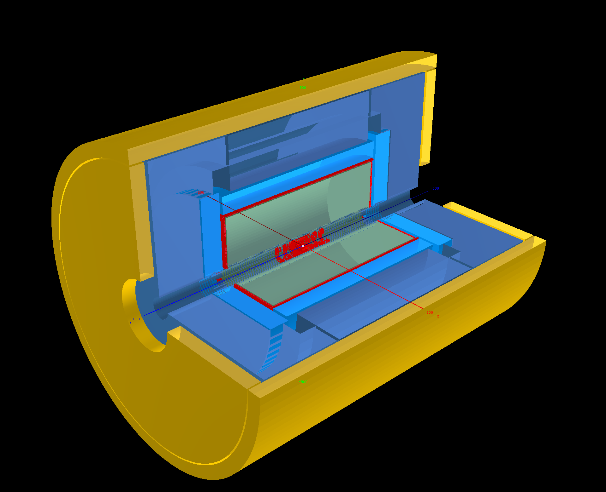
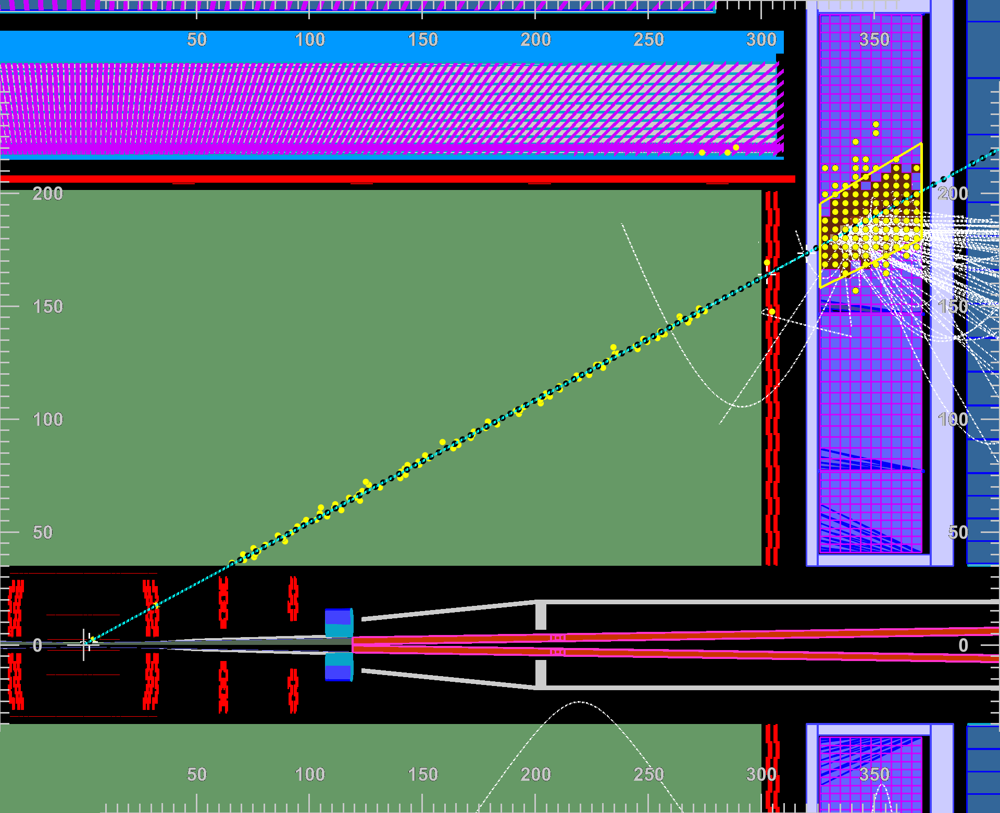
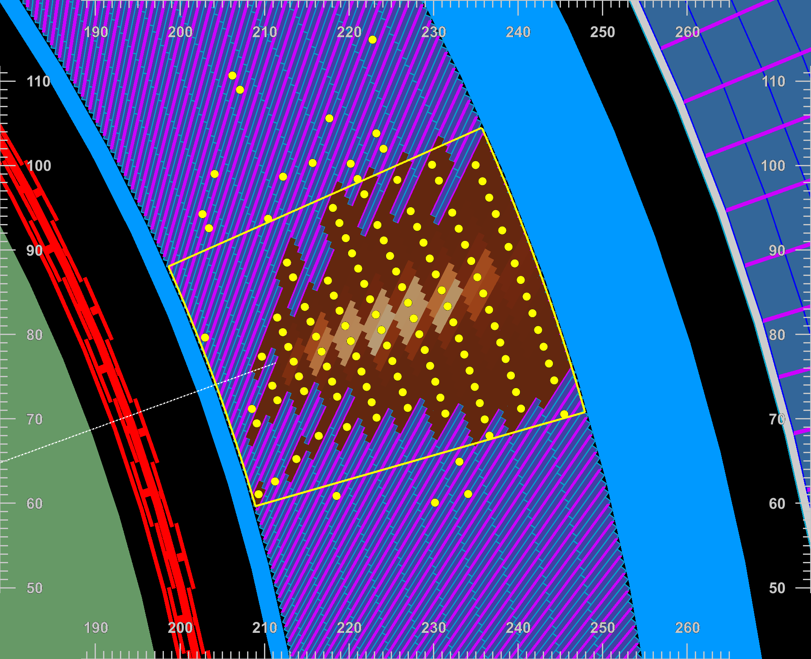
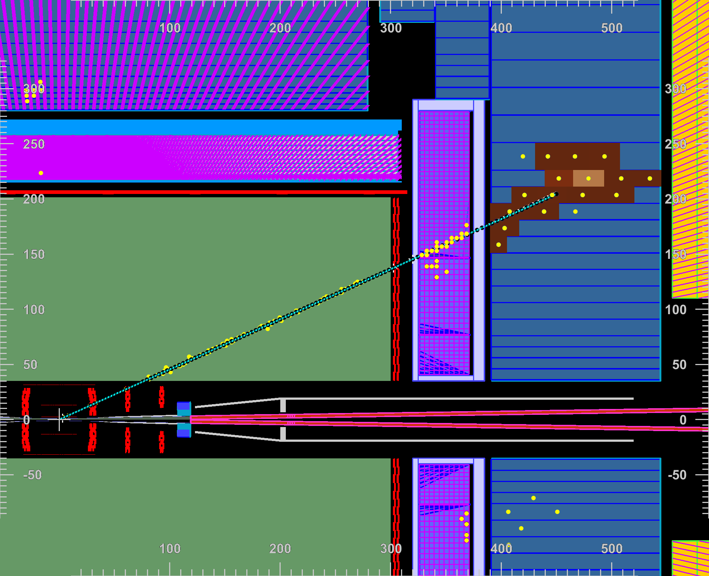
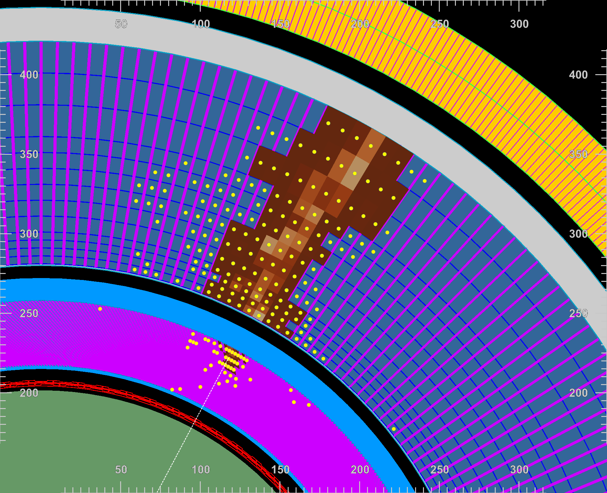
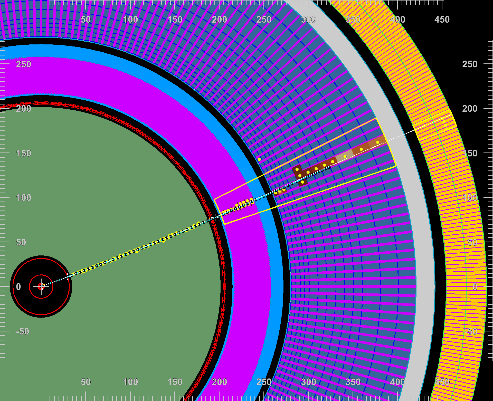

# calodisplay: an event display for the ALLEGRO detector

- [Description](#description)
- [Screenshots](#screenshots)
- [Installation](#installation)
- [Usage](#usage)
  - [Running in a VNC session (hardware OpenGL with VirtualGL)](#running-in-a-vnc-session-hardware-opengl-with-virtualgl)
  - [Navigation](#navigation)
  - [Configuration](#configuration)
  - [Input event files](#input-event-files)
  - [Detector geometry](#detector-geometry)
- [Code structure](#code-structure)
- [Troubleshooting](#troubleshooting)
- [Author](#author)
- [Acknowledgements](#acknowledgements)

## Description
ALLEGRO event display (with an emphasis on the calorimeter system).
Note: development of this tool started in early 2023 as a way of helping debugging the ECAL digitisation with the new segmentation classes under development.
I became aware only later of existing event display tools. It is likely that those tools (e.g. DDEve) can - after proper customisation for the non projective ECAL cell geometry for instance - provide similar functionality as well as many more features with a more robust code.

Works with ALLEGRO models o1_v03 and o2_v01 as of July 2026.

## Screenshots

<table>
  <tr>
    <td width="50%" align="center" valign="top">
      <br>
      <em>The ALLEGRO detector (3D view)</em>
    </td>
    <td width="50%" align="center" valign="top">
      <br>
      <em>An electron in the endcap (rho-z view) - track and SW ECAL cluster</em>
    </td>
  </tr>
  <tr>
    <td width="50%" align="center" valign="top">
      <br>
      <em>A photon in the barrel (rho-phi view) - SW ECAL cluster</em>
    </td>
    <td width="50%" align="center" valign="top">
      <br>
      <em>A negative pion in the endcap (rho-z view) - track and topological ECAL+HCAL cluster</em>
    </td>
  </tr>
  <tr>
    <td width="50%" align="center" valign="top">
      <br>
      <em>A K0L in the barrel (rho-phi view) - topological ECAL+HCAL cluster</em>
    </td>
    <td width="50%" align="center" valign="top">
      <br>
      <em>A negative muon in the barrel (rho-phi view) - track, SW ECAL+HCAL and MUON clusters. TODO</em>
    </td>
  </tr>
</table>

## Installation
Make a local clone of the repository:
```
git clone git@github.com:giovannimarchiori/calodisplay.git
cd calodisplay
```

Setup ROOT and the environment with:
```
source setup.sh
```
(if ROOT is already set up, i.e. `ROOTSYS` is set, it is used as is; otherwise, on lxplus and fcc-ironic ROOT is set up from the nightly key4hep stack).
`setup.sh` also checks whether calodisplay is compiled, up to date with the sources, and built with a ROOT version compatible with the one set up and with the same compiler (e.g. not the system GCC for a build made with the one of key4hep, which an incremental build would mix, and the library could then fail to link), and tells you whether to run `make -j8` or `make clean` followed by `make -j8`.

Compile:
```
make -j8
```

Download detector model file and an example event file:
```
source getdata.sh
```


## Usage
Setup ROOT and the environment with:
```
source setup.sh
```

Execute with e.g.
```
calodisplay -g data/ALLEGRO_o1_v03_noDCHcells.root  -e data/allegro_o1_v03_evts_10_pdg_11_MomentumMinMax_10.0_10.0_GeV_ThetaMinMax_90.0_90.0_PhiMinMax_0_360_HCal_ON_digi_reco.root -c config.json --fulldet
```
Execute with `calodisplay -h` to see available options:
- `-g|--geometry <geomFile.root>`: ROOT file with the detector geometry
- `-e|--events <eventFile.root>`: EDM4hep file with the events to display
- `-c|--config <configFile.json>`: configuration file (default: `config.json`)
- `-s|--skipEvents <nevents>`: number of the first event to display
- `--nog4`: use a simplified geometry rather than the G4 geometry in the geometry file
- `--fulldet`: show the full detector (including tracker, muon detector, interaction region), with HCAL and endcaps
- `--dohcal`: show the HCAL volumes and readout (without `--fulldet`, only the em calorimeters are shown)
- `--doendcap`: show the ECAL and (with `--dohcal`) HCAL endcaps
- `--nocache`: read the full G4 geometry, not the one without the volumes that are never drawn from the geometry cache (see below)
- `--debug`: display extended information on the console during execution
- `--set <key>=<value>`: set a parameter of the configuration (see below), overriding the configuration file, e.g. `--set drawCaloClusters=true --set drawTopoClusters=false`. Can be repeated.
- `--screenshots <prefix>`: instead of starting the interactive display, save the views of the events to `<prefix>_ev<event>_<view>.png` and exit. The events start from the one given by `-s`; `--nevents <n>` sets their number (default 1), `--views` the comma-separated views (`3d`, `rhophi`, `rhoz`, default all) and `--width` the width of the images in pixels (default 1920). An X display is still needed (e.g. a VNC session). The framing of the projections can be set automatically with `--focus cluster` (the most energetic cluster) or `--focus track` (the most energetic charged particle) or `--focus track+cluster` (both, e.g. for a charged particle and its shower), while the 3D view shows the full detector, optionally with the scale of the framed region (e.g. `--focus cluster:3`, default 2 for clusters and 1.2 otherwise), or view by view with `--camera <view>=<values>` (`rhophi=<x>,<y>,<zoom>`, `rhoz=<z>,<rho>,<zoom>`, `3d=<fov>,<center x,y,z>,<eye x,y,z>,<up x,y,z>`). The camera used for each screenshot is printed, and the Camera button of the display prints the one of the current view, to frame a view interactively and reuse it.

The script `scripts/make_screenshots.sh` produces single-particle events (e.g. an electron in the endcap, a photon in the barrel) with `run.py` of the FCC full-simulation setup and saves the screenshots of their event displays: see the comments at its beginning for the list of samples and the options.

What is drawn of the events (particles, tracks, hits, cells, clusters) is set in the configuration (`drawXXX` keys), independently of `--fulldet`, `--dohcal` and `--doendcap`, which select the detector geometry.

`calodisplay` can be run from any directory: relative paths of the configuration, geometry and field map files, and the icons, are looked up first in the current directory and then in the installation directory (`$CALODISPLAY_DIR`, set by `setup.sh`, or otherwise the parent of the directory containing the executable).

The ECAL barrel layout is deduced from the name of the geometry file: names containing `o1_v03` or `o2_v01` correspond to the ECAL barrel with 11 layers, the others to the older version with 12 layers. A warning is printed if the number of layers in the geometry does not match.

### Running in a VNC session (hardware OpenGL with VirtualGL)
Inside a VNC session, OpenGL applications use software rendering (Mesa llvmpipe), even if the machine has a GPU, and the display can be slow.
If the machine has a GPU and [VirtualGL](https://virtualgl.org) is installed and configured, run the event display with `vglrun` to render on the GPU:
```
vglrun calodisplay -g data/ALLEGRO_o1_v03_noDCHcells.root -e <events.root> -c config.json --fulldet
```
Check that `vglrun glxinfo -B` reports the GPU as renderer.

### Navigation
The navigation bar at the bottom contains:
- a button to take a screenshot of the selected view
- the event number box: type an event number and press Enter to go to that event, or use the up/down arrows to go to the next/previous event. The range of the available events is shown next to the box. An error pop-up is shown for events out of range.
- a button to hide/show the calorimeter readout grid
- a button to hide/show the legend of the cell energies
- a button to show the current camera location and zoom level

### Configuration
The configuration is read from a JSON file (see `config.json`), containing a map of key-value strings. Keys not specified in the file keep their default values (see `src/DisplayConfig.cpp`). The main keys are:
- `drawXXX` (`true`/`false`): whether to draw a given type of objects, e.g. `drawGenParticles`, `drawTracks`, `drawVertexHits`, `drawMainTrackerDigis`, `drawECalBarrelHits`, `drawECalBarrelCells`, `drawHCalEndcapCells`, `drawMuonHits`, `drawTopoClusters`, `drawCaloClusters`, `drawMuonClusters`, `drawClusterDirection`, `drawClusterBarycenters`, ...
- collection names, e.g. `genParticles`, `tracks`, `vertexBarrelHits`, `mainTrackerDigis`, `ecalBarrelHits`, `ecalBarrelCells`, `hcalEndcapCells`, `muonBarrelCells`, `topoClusters`, `topoClusterCells`, `caloClusters`, `caloClusterCells`, `muonClusters` (the sliding-window clusters in the muon tagger, e.g. `MuonCaloClusters`), ...
- energy thresholds in GeV: `energyThresholdParticles`, `energyThresholdHits`, `energyThresholdCells`, `energyThresholdClusters`, `energyThresholdMuonClusters` (for the clusters in the muon tagger, whose energies are of O(0.1 GeV))
- `showCellEnergyLegend` (`true`/`false`): whether the legend of the cluster cell energies is shown in the projections at startup (it can then be shown/hidden with its button)
- `showReadout` (`true`/`false`): whether the readout grids are shown at startup (they can then be shown/hidden with their button)
- `scaleMarkers` (`true`/`false`, default `true`): the markers of the hits, digis, cells and cluster barycenters have a size in the detector, converted to pixels with the zoom of each view between a minimum and a maximum (the sizes are set in `src/Globals.cpp`), so that they shrink when zooming out; with `false` they have a fixed size in pixels
- `bField`: `GlobalSolenoid` (default) for an ideal solenoid with B = 2 T inside (and -1 T in the return yoke), `GlobalSolenoid_<B>T` (e.g. `GlobalSolenoid_3T`) for an ideal solenoid with B = `<B>` T inside (and -`<B>`/2 T in the return yoke), otherwise the path of the ROOT file with the field map, or an empty string for the default field map `data/ALLEGRO_fieldmap_2T_20260424.root`. If the field map cannot be read, the ideal solenoid field is used. With `printFieldMap` set to `true`, the field map is printed on the terminal and drawn in `field.pdf`.
- `bkgColor3D`: background colour of the 3D view

### Input event files
The event file is a podio/EDM4hep ROOT file, e.g. produced by the ALLEGRO simulation, digitisation and reconstruction chain.
- The cellID encodings of the calorimeter cell collections are read from the metadata of the file (`<collection>__CellIDEncoding`). If they are not found, default encodings are used.
- The cells of the clusters are taken from the dedicated cluster cell collections (`topoClusterCells`, `caloClusterCells`) if present in the file. Otherwise, the links stored in the clusters to the cells of the cell collections in the file (e.g. `ECalBarrelModuleThetaMergedPositioned`) are followed.
- Several collections of clusters of the same type can be drawn at the same time, e.g. in the barrel and in the endcap, by listing them separated by commas, with their cell collections (if any) in the same order:
  ```json
  "caloClusters": "AugmentedEMBCaloClusters,AugmentedEMECCaloClusters",
  "caloClusterCells": "EMBCaloClusterCells,EMECCaloClusterCells",
  ```
  Each collection is drawn as a separate set of clusters. An empty or missing entry in the list of cells means that the default name (the name of the clusters, ending in `Cells` instead of `s`) is tried, and then the links.

### Detector geometry
The geometry files contain all the volumes of the detector (about 850k for ALLEGRO o1_v03), but only a small fraction of them is drawn. To make the display start faster, the first time a geometry file is used with a given set of options (`--fulldet`, `--dohcal`, `--doendcap`), the volumes that can be drawn in one of the views are determined, and the geometry without the other volumes is saved in a cache file, `<geometry>.displaycache.root`, next to the geometry file (or in `~/.cache/calodisplay` if that directory is not writable). The following times the geometry is read from the cache: e.g. with `--fulldet` the startup time goes from about 60 s to about 10 s. The cache is rebuilt automatically when the geometry file changes or when the code that decides which volumes are drawn changes (identified by a hash of the functions listed in `scripts/geometry_code_version.sh`, computed when calodisplay is compiled), and the cache file is compacted when the rebuilt entries have left too much unused space in it. With `--nocache`, the full geometry is read (and all the volumes can be turned on in the browser).

To create the root file with the detector geometry (if that on the website is outdated):
- create the GDML file from Geant4 with ddsim (do e.g. `ddsim --numberOfEvents 0 --enableGun --compactFile $K4GEO/FCCee/ALLEGRO/compact/ALLEGRO_o1_v03/ALLEGRO_o1_v03.xml  --geometry.dumpGDML ALLEGRO_o1_v03.gdml --runType run`)
- convert the GDML to ROOT with `util/gdmltoroot.C`:
```
cd util
root
.L gdmltoroot.C+
gdmltoroot("../data/ALLEGRO_o1_v03_noDCHcells.gdml","../data/ALLEGRO_o1_v03_noDCHcells.root", "world")
```
- for allegro_o1_v03, I had to remove from the gdml all DCH cells since they use a volume (G4TwistedTube) not available in ROOT. Note that the latest version (July 2026) uses a very detailed model of the vertex detector that is making the rendering pretty slow, so consider hiding the elements/show the envelope only/..


## Code structure
The package is organised in the following subdirectories:
- `src`: contains the source code of the event display
- `util`: contains the script to convert a GDML file to ROOT
- `data`: contains the ROOT files with the detector models and the magnetic field map
- `icons`: contains the icons of the navigation bar
The main directory contains the Makefile, the setup shell script, and the json files containing configuration parameters for the event display.
Compiling the code creates:
- `build`: for intermediate object files and the ROOT dictionary source
- `dist`: for the shared library, the ROOT dictionary file and the executable.


## Troubleshooting
In case of errors, check that eve is installed
```
root-config --has-opengl
root-config --evelibs
```

Check that you can run the eve tutorials:
```
root $ROOTSYS/tutorials/eve/calorimeters.C
```

In case of certificate validation problems with davix, you can add `Davix.GSI.CACheck: n` to your .rootrc.

If failure persists, contact the author ;)


## Author
Giovanni Marchiori (APC Paris), giovanni.marchiori@cern.ch

## Acknowledgements
Many thanks to the Eve author, Matevz Tadel, for many useful suggestions.
